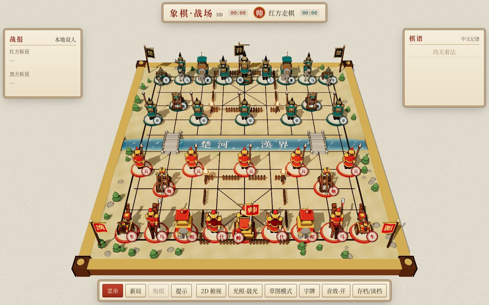

# 象棋·战场（xiangqi-battlefield）

**在线试玩：<https://2023anita.github.io/xiangqi-battlefield/>**

一款在浏览器里运行的 **3D 中国象棋“战场”游戏**：棋子是兵种化的小军队——帅/将坐镇指挥台、仕持塔盾护卫、相/象为披甲战象、马为骑兵、车为马拉弩车、炮为配重投石机、兵/卒为长枪兵。卡通描边 + 工笔重彩配色，沙盘地形、会流动的楚河汉界、九宫营寨，另有黑白「草图模式」还原线稿风格。



## 怎么玩

- **直接双击 `index.html`** 即可离线运行（three.js、PeerJS 等已全部内联，无需联网、无需服务器）。
- 也可托管在 GitHub Pages：`https://<用户名>.github.io/xiangqi-battlefield/`（只用相对路径，单文件）。
- 点击己方棋子选中，金色光点为可走位置、红圈为可吃子；再点目标即可走棋。
- 拖动旋转、滚轮/双指缩放、右键/双指平移；「2D 俯视」切换为传统平面视角。

## 功能

| 类别 | 内容 |
| --- | --- |
| 规则 | 完整规则：蹩马腿、塞象眼、象不过河、仕/帅不出九宫、炮隔一子吃、兵过河方可横走、将帅不能照面、不能送将；判定将军、将死（绝杀）、困毙（无子可动判负）。简化和棋：三次重复局面、六十回合未吃子、双方无进攻子力 |
| 模式 | 本地双人；人机对战（易/中/难，执红或执黑）；在线联机（WebRTC 点对点） |
| AI | α-β 剪枝 + PVS、迭代加深、置换表、MVV-LVA/杀手/历史启发、静态搜索、将军延伸、空着裁剪；在 Web Worker（Blob 内联）中运行，画面不卡顿 |
| 动画 | 行军/奔马/车轮滚动；吃子特写：投石机抛射石弹越过炮架砸中目标（碎石、烟尘、镜头震动）、战车冲撞、骑兵飞跃、长枪突刺、战象践踏、仕/帅挥剑；被吃棋子倾倒、碎裂淡出 |
| 提示 | 将军：将台红光 + 「将军」横幅；绝杀：胜方镜头环绕 + 胜负横幅 |
| 记谱 | 中文记谱（如 炮二平五、马8进7、前炮平五），悔棋，提示（军师推演最佳着法） |
| 存档 | 「存档/读档」：`FEN` 或 `FEN moves h2e2 h9g7 …`（UCCI 风格，可悔棋），并自动保存到本地 |
| 画面 | 晨光 / 黄昏 / 夜战（火盆照明）三种光照；草图模式；字牌（悬浮棋字）；ACES 色调映射、柔和阴影、泛光 |
| 声音 | 程序化 WebAudio：战鼓、马蹄、车轮、投石机、金属碰撞、碎石、铜锣；可静音 |
| 设备 | 桌面与手机（触控、竖屏自适应，棋谱可折叠） |

## 在线联机

1. 「菜单 → 在线联机 → 创建房间」，选择执红/执黑，得到 6 位房间码和邀请链接（`index.html?room=XXXXXX`），可一键复制。
2. 好友打开链接，或在「加入房间」输入房间码。
3. 同步内容：走子、悔棋请求/同意、求和、认输、再来一局（交换先后手）。房主为权威端，只接受合法着法；断线后自动重连，连接建立时房主发送完整局面重新同步；房主刷新页面可凭 `?room=…&host=1` 恢复房间（同一标签页）。
4. 信令使用 PeerJS 公共服务器，打洞使用 Google / Cloudflare STUN。**没有 TURN 中继**：部分公司/校园网络或对称 NAT 下可能无法直连，此时会提示「网络限制，建议换网络或稍后重试」。
5. 可选自建信令服务器：在链接后加 `&peerserver=主机:端口/路径`（例如本地测试用 `localhost:9123/xq`）。

> 建议通过 https（如 GitHub Pages）使用联机；直接双击打开（file://）时，个别浏览器可能拒绝连接公共信令服务器。

## 开发

```bash
node build.js                 # src/ + vendor/ → index.html（单文件）
node test/engine.test.js      # 规则测试：perft(1..3)=44/1920/79666，加 --deep 测 perft(4)=3290240
# 浏览器测试（需安装 playwright + chromium）
node test/browser.test.js ai                      # AI Worker、人机悔棋
node test/browser.test.js online --local-broker   # 两个无头页面经本地 PeerJS 服务器联机（需 npm i peer）
node test/screenshots.js [start|sketch|capture|2d|dusk|night|close|mate|check|mobile|menu]
```

修改 `src/` 后务必重新运行 `node build.js`。

## 已知限制

- 未实现长将、长捉等复杂禁着裁决（以三次重复局面判和代替）。
- 计时器只统计双方用时，没有限时判负。
- 联机无 TURN 中继服务器；公共 PeerJS 服务器偶有不稳定。
- 易级 AI 会随机走出明显的弱着（有意为之）。

## 许可

本项目代码可自由使用。内置第三方库：three.js r170（MIT，见 `vendor/LICENSE-three.txt`）、PeerJS 1.5.4（MIT，见 `vendor/LICENSE-peerjs.txt`）。
